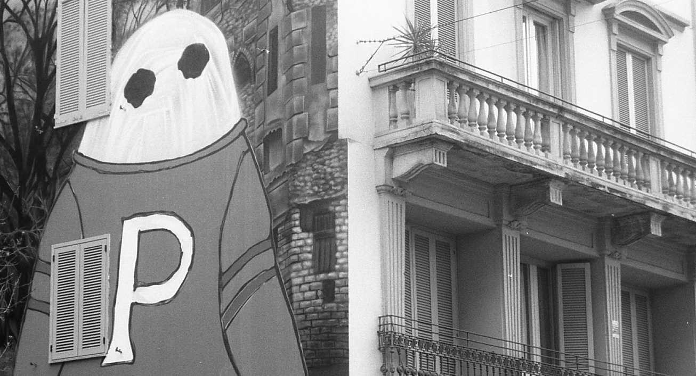

  

### Thesis Supervision

0. Matteo Bisi (co-supervised with G. Paolini and K. Tent). Master Thesis: *Model Theory of Homogeneous Combinatorial Structures*. Academic Year 2025/2026.
1. Emiliano Colla (co-supervised with G. Paolini). Master Thesis: *Abstract elementary classes and Modules*. Academic Year 2024/2025.
2. Fabio Carrozzo (co-supervised with G. Paolini). Master Thesis: *$\aleph_0$-categorical structures, oligomorphic groups and their topological automorphisms*. Academic Year 2024/2025.
